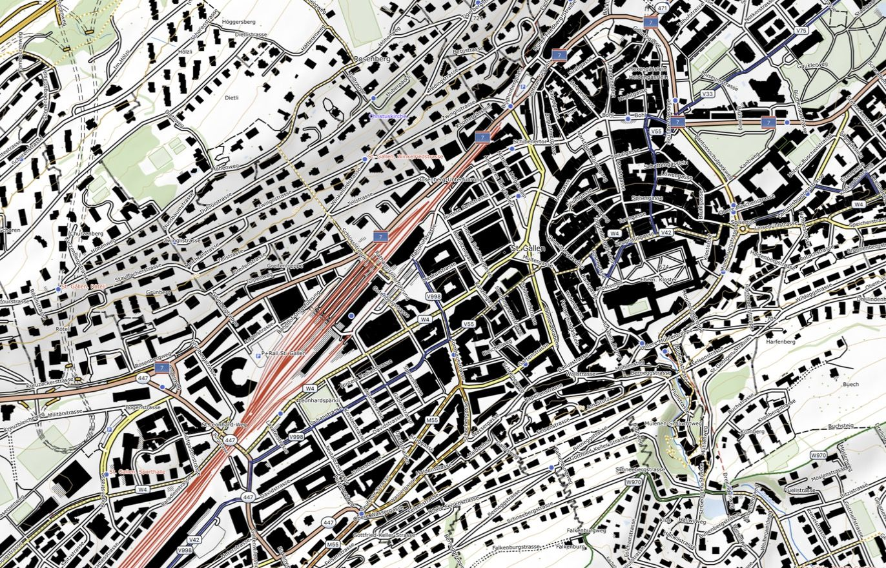
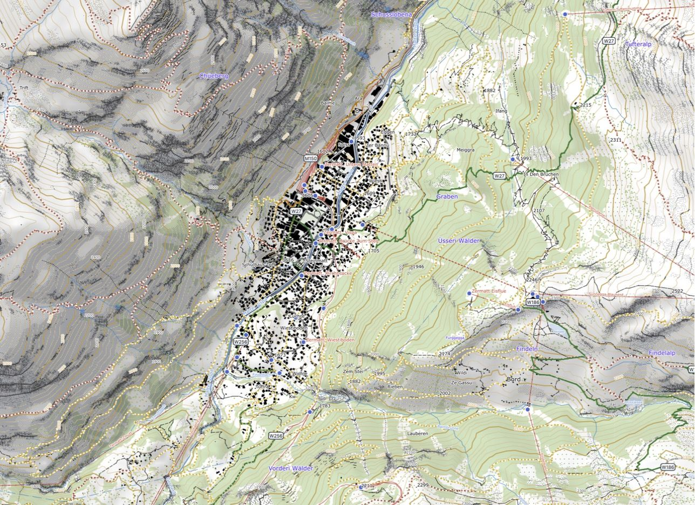

# Helvetopo

**Karten der Schweiz für Garmin-Geräte, gebaut aus freien swisstopo-Geodaten.**

> **Karten herunterladen:** [helvetopo.sackmesser.dev](https://helvetopo.sackmesser.dev)
> mit allen Karten, Installationsanleitung und FAQ. Dieses Repository enthält nur den Quellcode.

Helvetopo macht aus den Open-Government-Data von swisstopo und den SchweizMobil-Routen Karten
für Garmin-Handhelds (GPSMAP, Montana, eTrex, Oregon) und für Garmin BaseCamp:

- **Vektorkarte** (IMG, routingfähig): Basiskarte aus swissTLM3D mit Adress-, Orts- und
  POI-Suche, Schummerung und Höhenlinien aus swissALTI3D, Wanderwege und SchweizMobil-Routen.
  Farben, Linien und Beschriftung sind möglichst eng an der Landeskarte 1:25'000
  (Swiss Map Vector 25) gehalten, und die Nähe wird gemessen statt geschätzt.
- **Routen-Overlay** (IMG, transparent): Wanderwege und SchweizMobil-Routen, am Gerät über
  jede Karte schaltbar.
- **Pixelkarte** (Raster-IMG, experimentell): Swiss Map Raster 1:10'000 bis 1:1'000'000 als Garmin-IMG.
- **Luftbild** (Raster-IMG, experimentell): SWISSIMAGE als Garmin-IMG.

> **Inoffizielles Projekt.** Helvetopo ist keine Karte von swisstopo, vom ASTRA oder von der
> Stiftung SchweizMobil und wird von diesen Stellen weder herausgegeben noch geprüft.
> Garmin, BaseCamp, GPSMAP, Montana, eTrex und Oregon sind Marken von Garmin Ltd.
> Das Projekt steht in keiner Verbindung zu Garmin.

<p>
  
  
</p>
<sub>Kartendaten ©swisstopo. Routen: Bundesamt für Strassen, Kanton, Stiftung SchweizMobil.</sub>

## Stand

Das erste Release ist **2026-11**. Es deckt die ganze Schweiz und Liechtenstein ab.
- **Vektorkarte:** läuft in BaseCamp und auf dem GPSMAP 67, mit Routing für Fuss und Velo
  (Wanderwege und Veloland werden bevorzugt).
- **Pixelkarte (Raster-IMG):** läuft in BaseCamp und auf dem GPSMAP 67. Je Zoomstufe steckt der
  passende Massstab in der Datei, von Swiss Map Raster 1:1'000'000 bis 1:25'000 bzw. 1:10'000.
  Sie bleibt als experimentell gekennzeichnet, bis mehr Geräte getestet sind.
- **Routen-Overlay:** läuft auf dem GPSMAP 67 über Vektor-, Pixel- und Luftbildkarte. Die
  ÖV-Haltestellen zeigt das Gerät erst ab ca. 80 m.
- **Luftbild:** Standard für die ganze Schweiz in einer Datei, Detail in 18 Teilen. Beide sind
  experimentell.

Die Dokumentation beginnt bei [docs/README.md](docs/README.md), die Downloads beschreibt
[docs/build/release.md](docs/build/release.md).

Bekannte Grenzen:
- **Auto-Routing ist nur topografisch.** swissTLM3D kennt keine Einbahnen, Abbiegeverbote oder
  Tempolimits. Nicht zur Fahrzeugnavigation verwenden. Fuss- und Velorouting funktionieren gut.
- Garmin setzt Grenzen beim Stil (keine Kursivschrift, ganze Pixel bei Linienbreiten u. a.),
  siehe [docs/stil/soll-ist.md](docs/stil/soll-ist.md).
- Für Touren im Gebirge immer zusätzlich die offizielle Landeskarte verwenden.

## Karten installieren

Die fertigen Karten gibt es auf **[helvetopo.sackmesser.dev](https://helvetopo.sackmesser.dev)**,
mit Prüfsummen (SHA-256), README und Quellstand je Release. Die Kartendateien liegen nicht auf
GitHub, weil viele grösser als 2 GiB sind.

- **Gerät:** Die `.img`-Datei in den Ordner `Garmin/` auf dem Gerät oder der microSD-Karte kopieren.
- **BaseCamp:** Das ZIP entpacken und den `.gmap`-Ordner kopieren nach
  `~/Library/Application Support/Garmin/Maps/` (macOS) bzw. `C:\ProgramData\Garmin\Maps\` (Windows).

## Selbst bauen

Die Kette läuft unter macOS (Apple Silicon) und sollte unter Linux ebenso laufen.

Voraussetzungen:
- [mkgmap](https://www.mkgmap.org.uk/) r4924 und [splitter](https://www.mkgmap.org.uk/doc/splitter.html) r654 in `tools/`, dazu Java
- [GDAL](https://gdal.org/) und [osmium-tool](https://osmcode.org/osmium-tool/), z. B. per Homebrew
- Python 3 in einem venv (`.venv/`) mit numpy, scipy, shapely, pyogrio, pyproj, Pillow und den GDAL-Bindings

Die Geodaten lädt die Pipeline über den STAC-Katalog `data.geo.admin.ch` nach `downloads/`.

`downloads/`, `tools/` und `.venv/` liegen im Wurzelordner des Checkouts. Aus einem Git-Worktree
heraus nehmen die Skripte automatisch die des Haupt-Checkouts. Einen anderen Ort setzt die
Umgebungsvariable `HELVETOPO_ROOT` (siehe `src/paths.py` und `src/paths.sh`).

```bash
src/build/build_all.sh
```

baut das Testgebiet Wil–St. Gallen–Säntis. Die ganze Schweiz (`PROFILE=ch`, ca. 7 min und
~15 GB RAM) und alle Variablen beschreibt
[docs/build/build.md](docs/build/build.md).

## Aufbau

| Ordner | Inhalt |
|---|---|
| `src/vector/` | swissTLM3D → OSM-PBF mit eigenem Tag-Schema ([docs/daten/tag-schema.md](docs/daten/tag-schema.md)) |
| `src/style/` | mkgmap-Stil und TYP-Datei nach Swiss Map Vector 25 |
| `src/style_qa/` | Messung der Stilnähe gegen SMV25 und SMR25 ([docs/stil/messung.md](docs/stil/messung.md)) |
| `src/dem/` | swissALTI3D: Schummerung, Höhenlinien, Höhenkoten |
| `src/routes/` | Wanderwege und SchweizMobil-Routen als Overlay |
| `src/raster_img/` | Raster-IMG-Encoder für Swiss Map Raster ([docs/raster/raster-img.md](docs/raster/raster-img.md)) |
| `src/raster_kmz/` | Custom Maps (KMZ) für den Eigenbedarf |
| `src/build/` | Gesamtbuild, Lizenzprüfung, README/LICENSE für die Downloads |
| `src/portal/` | Downloadseite |
| `docs/` | Analysen, Formatnotizen, Entscheide |

Die Doku ist auf Deutsch, der Code ist auf Englisch benannt.

## Entstehung: Vibe-Coding mit Claude

Helvetopo ist ein **Vibe-Coding-Projekt**. Der Code und die Doku sind fast vollständig im Dialog
mit [Claude](https://claude.com/claude-code) (Anthropic) entstanden: Ich habe Ziele,
Entscheide und Tests vorgegeben, Claude hat in mehreren parallelen Sessions recherchiert,
programmiert, gebaut und dokumentiert. Die Ergebnisse habe ich in BaseCamp und auf dem Gerät
geprüft, aber nicht jede Zeile Code gelesen.

Das heisst konkret: Der Code funktioniert für die getesteten Fälle, ist aber nicht überall
schön, einheitlich oder vollständig geprüft. Hinweise auf Fehler sind sehr willkommen.
`AGENTS.md` enthält die Arbeitsregeln für die KI-Sessions. Sie sind absichtlich im Repo.

## Mitmachen

- **Fehler, Darstellungsprobleme, falsche Daten:** bitte ein
  [Issue](../../issues/new/choose) eröffnen, möglichst mit Ort (Koordinaten), Zoomstufe,
  Gerät bzw. BaseCamp-Version und Screenshot.
- **Verbesserungen und neue Funktionen:** bitte als **Pull Request**. Bei grösseren Änderungen
  zuerst ein Issue zur Abstimmung eröffnen.
- Details: [CONTRIBUTING.md](CONTRIBUTING.md).

Es ist ein Freizeitprojekt. Antworten können dauern.

## Lizenz

**Code** (alles in diesem Repository, sofern nicht anders vermerkt):
[GNU General Public License v3.0 oder später](LICENSE) (GPL-3.0-or-later).
Wer den Code verändert und weitergibt, auch in einem kommerziellen Produkt, muss den Quellcode
unter derselben Lizenz offenlegen. Einige Module setzen Formatwissen aus GPL-Projekten um
(siehe Credits). Auch deshalb ist die GPL die passende Lizenz.

**Karten** (die erzeugten IMG- und gmap-Dateien): Sie bestehen aus freien Geodaten unter
Open Government Data bzw. Open Data BY. Nutzung und Weitergabe sind erlaubt, sofern die
Quellenangaben erhalten bleiben. Details und Wortlaut: [LICENSE-KARTEN.md](LICENSE-KARTEN.md).

Pflicht-Quellenangaben:
- `©swisstopo`
- `Bundesamt für Strassen, Kanton, Stiftung SchweizMobil` (Wanderland, Veloland,
  Mountainbikeland, Skatingland)
- `Stiftung SchweizMobil` (Kanuland, falls enthalten)

## Credits

**Daten**
- [Bundesamt für Landestopografie swisstopo](https://www.swisstopo.admin.ch/) – swissTLM3D,
  swissNAMES3D, swissALTI3D, swissBOUNDARIES3D, Swiss Map Vector 25, Swiss Map Raster,
  amtliches Gebäudeadress- und Strassenverzeichnis (Open Government Data)
- [Bundesamt für Strassen ASTRA](https://www.astra.admin.ch/), die Kantone und die
  [Stiftung SchweizMobil](https://schweizmobil.ch/) – Routennetz von SchweizMobil (Open Data BY)

**Werkzeuge und Vorarbeiten**
- [mkgmap und splitter](https://www.mkgmap.org.uk/) (GPL) – erzeugen die Vektor-IMG
- [GDAL](https://gdal.org/) (MIT) und [osmium-tool](https://osmcode.org/osmium-tool/) (GPL-3.0)
- [QMapShack](https://github.com/Maproom/qmapshack) (GPL-3.0),
  [GPXSee](https://github.com/tumic0/GPXSee) (GPL-3.0),
  [GarminImg](https://github.com/kiozen/GarminImg) (GPL-3.0) und
  [ImageMagick](https://imagemagick.org/) – ihr Code diente als Referenz für das Garmin-IMG-
  und das JNX-Format
- Python-Bibliotheken: numpy, scipy, shapely, pyogrio, pyproj, Pillow
- [asd-ste100-skill](https://github.com/danyuchn/asd-ste100-skill) (MIT) – Grundlage der
  Schreibregeln, liegt in `.agents/skills/asd-ste100/`
- Mit [Claude Code](https://claude.com/claude-code) von Anthropic entwickelt

Danke an alle, die diese Daten und Werkzeuge frei zur Verfügung stellen.

## Haftungsausschluss

Die Karten und der Code werden ohne jede Gewähr bereitgestellt (siehe Abschnitte 15 und 16 der
GPL). Karten können Fehler enthalten und den aktuellen Zustand im Gelände nicht wiedergeben.
Die Nutzung erfolgt auf eigene Verantwortung.

---

*English summary:* Helvetopo turns free Swiss federal geodata (swisstopo OGD) and
SchweizMobil routes into Garmin maps (routable vector IMG, experimental raster IMG). It is an
unofficial, AI-assisted ("vibe-coded") hobby project. Code: GPL-3.0-or-later. Maps: free to
use and share with attribution (©swisstopo etc., see [LICENSE-KARTEN.md](LICENSE-KARTEN.md)).
Bugs → issues, improvements → pull requests.
